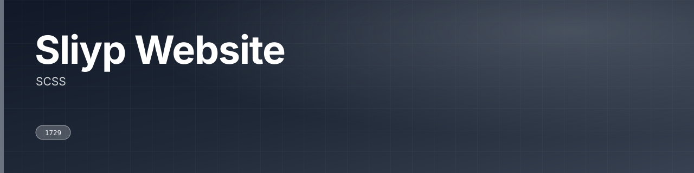
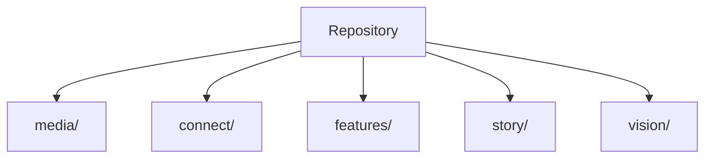

SCSS

 

  

---

## What this is

SCSS

|  |
|:--:|
| **1** |
| docs |

---

## Architecture

Derived from the directories present in this repository.

---

## Project structure

| Path | Contents | Files |
|---|---|---|
| `media/` | — | 18 |
| `connect/` | — | 5 |
| `features/` | — | 5 |
| `story/` | — | 5 |
| `vision/` | — | 5 |

45 tracked files in total.

---

<a href="https://github.com/gowtham-creator/sliyp-website">gowtham-creator/sliyp-website</a>

